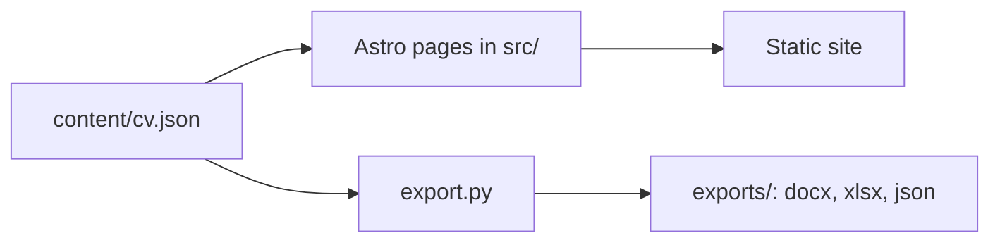

# Architecture
Summary: `content/cv.json` is the single source of truth. Astro (static) renders pages from it; `export.py` generates docx/xlsx/JSON into `exports/`. Private details stay in gitignored `content/private/`.

Stack default: Astro + plain CSS. Hosting: any static host.

## Sitemap (agreed M1)
| Page | Route | Purpose |
|---|---|---|
| Home | `/` | Positioning pitch, headline, top 3 projects, CTA |
| Story | `/story` | Career narrative: research, design, communication, regulatory affairs |
| Portfolio | `/portfolio` | Project cards (3-6) from `projects` in cv.json |
| CV | `/cv` | Live CV from cv.json + export downloads (docx, xlsx, JSON) |
| Contact | `/contact` | Public links only (LinkedIn, email form/link); no private data |

## Design tokens (M2, approved 2026-11-15)
Source: `src/styles/tokens.css` (plain CSS variables). Direction A "Lab Notebook", palette P1+.
- Base: paper `#FAF9F5`, ink `#141413`, surface `#E8E6DC`, muted `#5E5D59`.
- Accents (fill / text-safe): terracotta `#D97757` / `#A8472A` (actions); plum `#6B3F69` (labels); mustard `#D9A441` / `#7A5500` (highlighter); blue `#6A9BCC` / `#3B6A99` (links, info); green `#788C5D` / `#5A6D41` (skills, status).
- Rules: fills never carry text; button text is ink on terracotta; tags = tint bg + text-safe color; focus ring 3px blue-text.
- Type: Fraunces (headings), Inter (body); fluid scale; body 17px, line-height 1.65, measure 66ch.
- Spacing 4px base; radius 6/10/16.
- Contrast: 20/20 pairs pass (AA text 4.5:1, UI 3:1).
- Art: only CC0/MIT hand-made sets (Doodle Icons, Open Doodles, Highlights; Lucide for UI icons). No AI-generated art. No Claude logo or mascot.

## Wireframe notes (M2, approved 2026-11-15)
Source: `design/wireframes.html` (desktop 1280 + mobile 390 per page). Layout rules for the build; copy comes from `cv.json`.
- Shared: nav = name + Story, Portfolio, CV, Contact (burger on mobile). Footer = (c) name, LinkedIn, GitHub, "Behance (volunteer design work)". Container 72rem, text measure 66ch.
- Home: story-led hook (1 sentence, copy still to write with user), headline, CTAs "Read my story" + "See my CV", 3-chapter teaser, top 3 projects (cv.json), strengths chips (green tags), CTA band.
- Story: one vertical timeline, 4 chapters (Research; Design & communication; Regulatory affairs CMC; Now). Each has a mustard-highlighted outcome line; image beside text on desktop, hidden or stacked on mobile.
- Portfolio: 6 cards from `projects`; filter chips as plain anchors (no JS in v1). PATH and HaloTag are text-only cards ("client work").
- CV: rendered from cv.json. Desktop = sticky sidebar (downloads DOCX/XLSX/JSON + jump links); mobile = downloads on top. Print stylesheet planned.
- Contact: public links only (mailto, LinkedIn, GitHub, Behance). No form, no backend.
- Art in wireframes (doodle, cover) = placeholders for CC0/MIT sets.

## 3MT hand-drawn image (for build milestones)
File: `design/assets/3mt-defuse-timebomb.png` (2002x1125, 16:9, RGBA; user's own drawing). Use as a **framed feature, never a page background**:
1. Portfolio: cover of the "My PhD in 3 minutes" card (also shown in Home "Selected work").
2. Home: framed feature band (image + short caption, links to the 3MT card).
3. Story: Chapter 1 (Research) image slot.
4. Social share image (Open Graph/Twitter, 1200x630 crop; keep key drawing in the centre).
Build notes: move a copy to `src/assets/` and serve via Astro `<Image>` (webp/avif, sizes, width/height set) - never commit the raw PNG to `public/`; frame = 1px `--border-strong`, `--radius-md`, paper mat; alt text describes the drawing; check contrast of any caption on paper. Mobile: full width, no crop below 390px.
